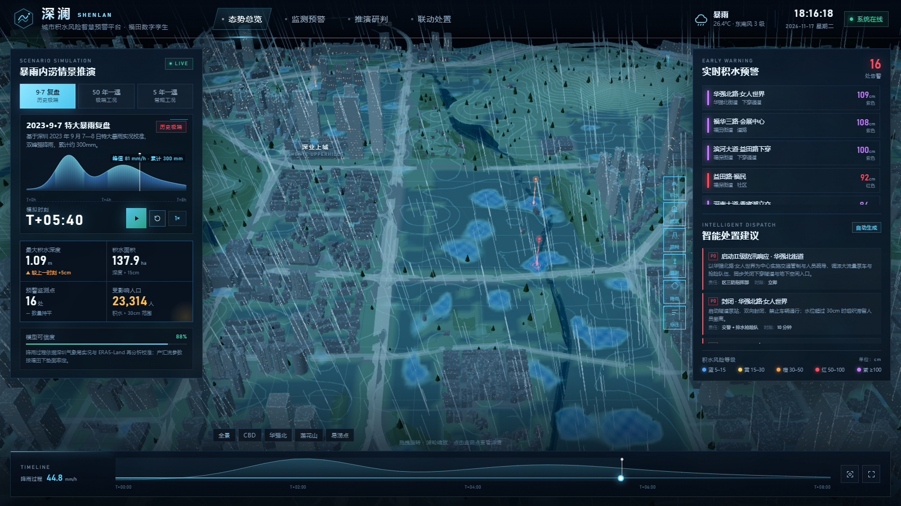

# 深澜 · 城市积水风险智慧预警平台

> 《智慧城市》课程结课设计 · 第 4 小组 · 2026 年 11 月  
> 深圳福田 26.7 km² 数字孪生 · 数据驱动的三维推演与四人协作

---

## 1. 这是什么

一套面向深圳市福田区的城市积水风险预警原型系统：

- **数据先行**：5 m DEM（24 块 Terrarium 瓦片）、3,871 栋 OSM 建筑、3,108 条道路、ERA5 历史降雨、深圳官方街道阈值；
- **模型可解释**：SCS-CN 产流 + 二维扩散波汇流 + 概化排水能力场，输出 9·7 复盘、50 年一遇、5 年一遇三套情景；
- **三维可感知**：Three.js/WebGL2，地形等高线、真实建筑天际线、随地形起伏的动态水面、7,000 条雨线、五级预警光柱；
- **处置可闭环**：五级色标 → P0—P3 处置建议 → 责任队伍与时限；
- **分工可落地**：系统完成度约 80%，剩余 20% 按数据/模型、三维/前端、平台/集成、产品/表达四条线拆分。

系统是课程答辩原型，**不用于真实防汛决策**。

---

## 2. 快速开始

```bash
cd system
node server.mjs
# 浏览器打开 http://127.0.0.1:8088
```

要求：Node.js 18+（推荐 24），浏览器 Chrome/Edge 90+（WebGL2）。  
不需要安装 npm 依赖即可运行；Three.js 已本地化到 `system/public/vendor/`。

### 操作

- 左栏切换三套情景，播放/暂停/倍速，拖动时间轴；
- 右侧查看按水深排序的告警与 P0—P3 处置；
- 点击告警或三维光柱，查看监测点 49 帧过程线；
- 右侧工具条切换积水/建筑/路网/监测/降雨/标注；
- 视角快捷：全景、CBD、华强北、莲花山、易涝点；
- 空格播放/暂停，←/→ 逐帧。

---

## 3. 交付物

| 交付物 | 路径 | 说明 |
|---|---|---|
| 设计报告（Word） | `docs/设计报告.docx` | 37 页，封面/目录/7 章/参考文献/附录 |
| 设计报告（PDF） | `docs/设计报告.pdf` | 与 DOCX 同版，便于提交与预览 |
| 设计报告（Markdown） | `docs/设计报告.md` | 可编辑源文，约 2.3 万字 |
| 答辩 PPT | `docs/答辩PPT.pptx` | 14 页，16:9，含演讲备注 |
| 答辩 PPT（PDF） | `docs/答辩PPT.pdf` | 便于无 PowerPoint 环境预览 |
| 3 分钟演示视频 | `video/城市积水风险智慧预警系统_演示视频.mp4` | 2:45，1280×720，中文旁白 + 字幕 |
| 视频字幕 | `video/演示视频字幕.srt` | 可单独加载 |
| 视频脚本 | `docs/演示视频脚本.md` | 分镜表 + 旁白全文 + 制作说明 |
| 四人分工方案 | `docs/四人分工与协作方案.md` | RACI、六周计划、剩余任务、答辩分工 |
| 背景调研 | `research/背景调研.md` | 9·7 实况、福田阈值、标准、案例、文献 |
| 报告图表 | `docs/figures/` | 研究区、雨型、水深、架构、甘特等 |
| 可运行系统 | `system/` | 前端 + Node 服务 + 数据 |
| 数据与模型管线 | `pipeline/` | 7 个可复现脚本 |
| 原始/处理数据 | `data/` | DEM、OSM、降雨、网格、情景诊断 |

---

## 4. 系统界面



---

## 5. 项目结构

```
.
├─ pipeline/                 # 数据与模型管线
│  ├─ config.py              # 研究范围、坐标系、网格参数
│  ├─ 01_fetch_dem.py        # DEM 瓦片下载/拼接/裁剪
│  ├─ 02_fetch_osm.py        # Overpass 抓取（含 OSM API 回退）
│  ├─ 02b_fetch_osm_grid.py  # OSM Map API 分块回退
│  ├─ 03_fetch_rainfall.py   # ERA5 降雨
│  ├─ 04_build_city.py       # 建筑/道路/水系/传感器/人口
│  ├─ 05_hydrology.py        # SCS-CN + 二维扩散波 + 情景输出
│  ├─ 06_calibrate_sensors.py# 监测点模型辅助选址
│  ├─ 07_figures.py          # 报告图表
│  ├─ 08_make_docx.py        # DOCX 生成
│  ├─ 09_map_toc.py          # 目录页码映射
│  ├─ 09_make_pptx.py        # PPT 生成
│  ├─ 10_voiceover.py        # 中文旁白
│  ├─ 11_video_cards.py      # 片头/片尾卡
│  └─ 12_video_script.py     # SRT/分镜脚本
├─ system/
│  ├─ server.mjs             # 零依赖静态服务 + API + 规则引擎
│  ├─ record_video.mjs       # 演示视频录屏脚本（需 Playwright）
│  └─ public/
│     ├─ index.html          # 指挥中心布局
│     ├─ src/                # scene/city/water/rain/markers/ui/main
│     ├─ vendor/             # Three.js 与 Addons（本地化）
│     ├─ assets/             # 视频用图表
│     └─ data/               # 地形/建筑/矢量/传感器/情景 JSON
├─ data/
│  ├─ raw/                   # DEM 瓦片、OSM、降雨原始数据
│  └─ processed/             # 模型网格、传感器、诊断、水深图
├─ docs/                     # 报告/PPT/视频脚本/图表
├─ research/                 # 背景调研与参考文献
└─ video/                    # 成片、旁白、字幕、片头片尾
```

---

## 6. 数据与模型

### 6.1 数据源

| 数据 | 来源 | 许可 |
|---|---|---|
| DEM | Mapzen Terrarium / AWS Open Data（z15，约 4.4 m） | 开放数据，需署名 |
| 建筑/道路/水系/绿地 | OpenStreetMap | ODbL 1.0 |
| 历史降雨 | Open-Meteo ERA5-Land | CC-BY 4.0 |
| 街道阈值/设计暴雨 | 深圳市气象局、应急管理局、水务局公开文件 | 公开信息 |

### 6.2 模型参数

| 参数 | 取值 |
|---|---|
| 网格 | 192×136（约 32 m） |
| 时间步长 | 6 s |
| 模拟时长 | 8 h / 4,800 步 |
| 输出帧 | 10 min / 49 帧 |
| 产流 | SCS-CN（绿地 58、其他 80、道路 96、建筑 94、水面 100） |
| 汇流 | 二维扩散波 + Manning（n=0.07），四邻域，建筑绕行 |
| 排水 | 概化能力场 12—60 mm/h |
| 情景 | 9·7 复盘 300 mm/81 mm/h；50 年 340 mm/96 mm/h；5 年 140 mm/44.5 mm/h |

### 6.3 结果

| 指标 | 9·7 复盘 | 50 年一遇 | 5 年一遇 |
|---|---|---|---|
| 最大水深 | 1.55 m | 2.33 m | 0.42 m |
| 最大积水面积 | 156.4 ha | 299.0 ha | 6.3 ha |
| 峰值受影响人口 | 27,468 | 58,236 | 779 |
| 峰值预警点 | 16/16 | 16/16 | 8/16 |

---

## 7. 复现

```bash
# 数据与模型（Python 3.14 + numpy/Pillow）
cd pipeline
python 01_fetch_dem.py
python 02_fetch_osm.py        # 失败时运行 02b_fetch_osm_grid.py
python 03_fetch_rainfall.py
python 04_build_city.py
python 05_hydrology.py
python 06_calibrate_sensors.py
python 05_hydrology.py        # 用校准后的点位重采样
python 07_figures.py

# 系统
cd ../system
node server.mjs
```

注意：`04` 与 `05` 的顺序会影响传感器序列；`06` 用 50 年情景的 max-depth 包络做模型辅助选址，随后必须重跑 `05`。

### 重新录制演示视频（可选）

```bash
cd system
npm install          # 仅安装 Playwright/Three 开发依赖
node record_video.mjs
# 再用 video/ 下的 ffmpeg 流程合成旁白、片头片尾
```

---

## 8. 四人分工（摘要）

| 角色 | 职责 | 交付物 | 工作量 |
|---|---|---|---|
| A（队长） | 需求、数据、模型、预警规则、报告统稿 | 数据管线、情景 JSON、报告终稿 | 30% |
| B | Three.js 场景、Shader、交互、性能 | 三维模块、演示环境 | 28% |
| C | Node API、数据契约、部署、测试 | server.mjs、API 文档、测试报告 | 22% |
| D | UI/UX、PPT、视频、答辩 | PPT、视频、答辩稿 | 20% |

详见 `docs/四人分工与协作方案.md` 与报告第 6 章。

---

## 9. 已知边界

1. 地下管网、逐点易涝点矢量、实时监测数据未公开，系统用**概化排水能力场 + 模型辅助选址的虚拟监测点**替代；
2. 河道未作为动态边界耦合，南部沿河顶托风险可能被低估；
3. 建筑高度 38.1% 有显式值，其余按类型/面积估算；
4. 降雨使用 ERA5 再分析，9·7 情景按官方总量校准，时间形态仍有不确定性；
5. 未做逐点实测率定；模型结果用于**相对风险排序与课程演示**，不作为真实预报；
6. 3D 截图在软件渲染（SwiftShader）下完成，帧率不代表独显表现。

---

## 10. 许可与致谢

- © OpenStreetMap contributors，ODbL 1.0；
- Mapzen Terrarium / AWS Open Data；
- Open-Meteo ERA5-Land，CC-BY 4.0；
- 深圳市气象局、应急管理局、水务局公开文件；
- 课程指导教师与第 4 小组全体成员。

本项目仅用于课程学习与研究，不用于商业用途或真实防汛决策。
