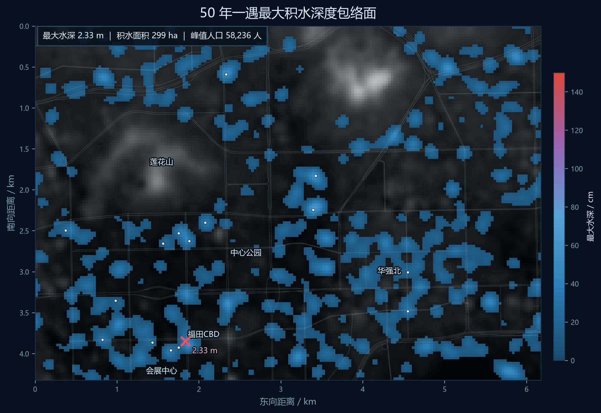
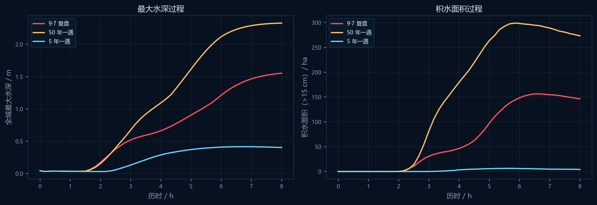
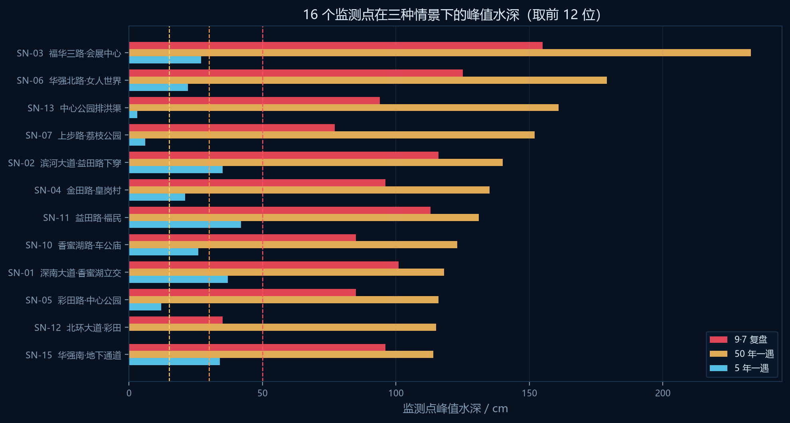
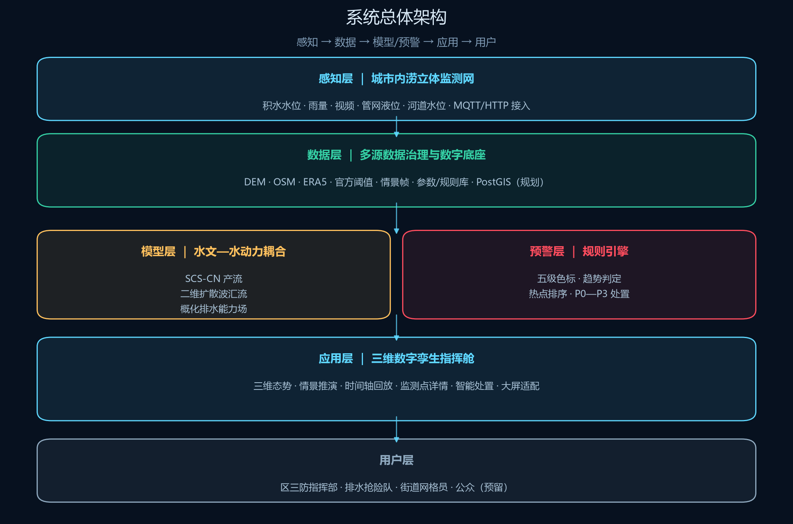
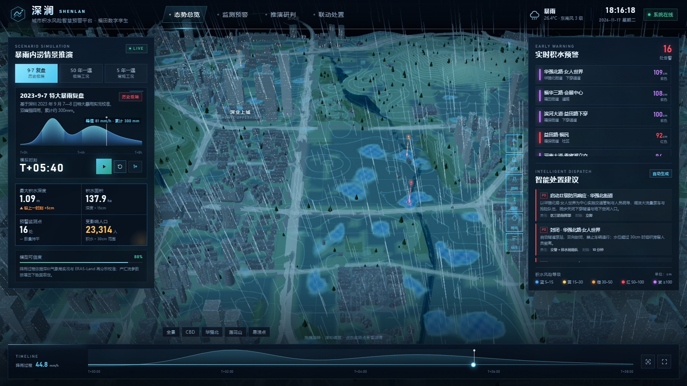
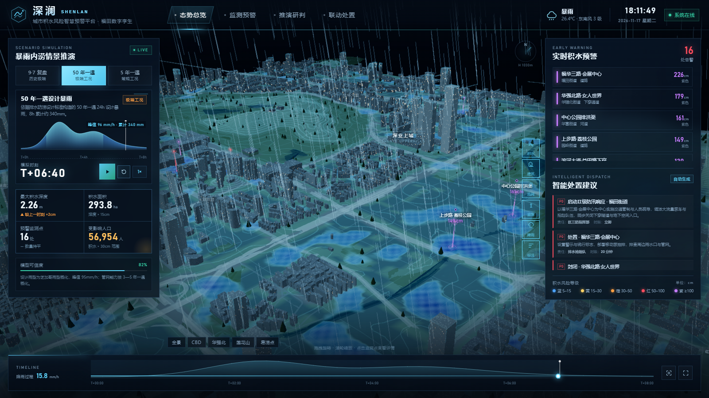
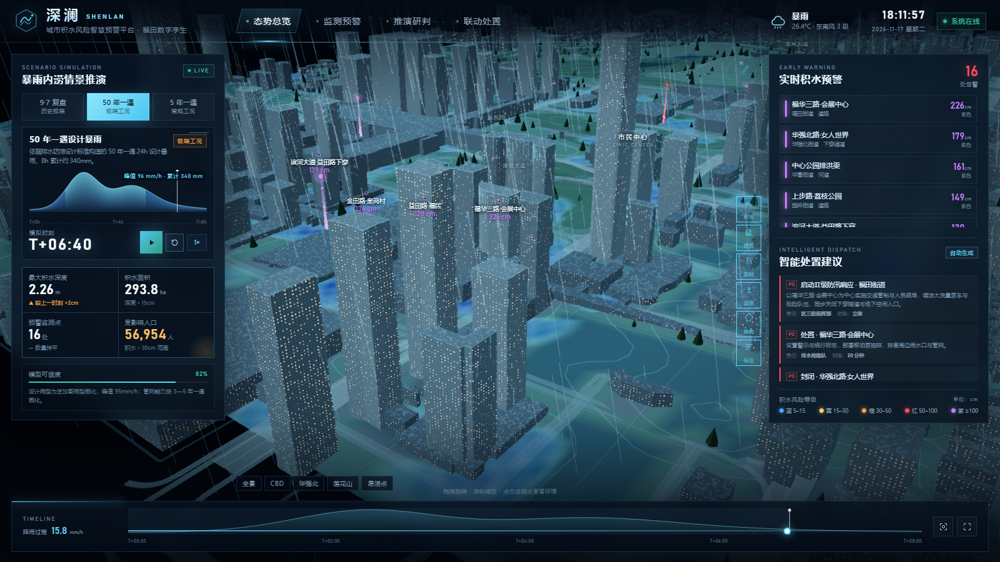
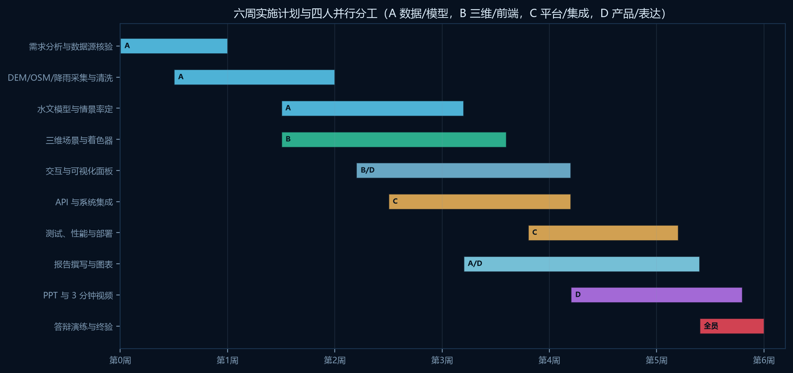

# 城市积水风险智慧预警系统设计报告

## ——深圳福田数字孪生 · 数据驱动的三维推演与四人协作实践

> 《智慧城市》课程结课设计 · 第 4 小组 · 2026 年 11 月

[TOC]

## 摘要

城市内涝是极端天气下最直接、最高频的智慧城市治理场景之一。2023 年 9 月 7—8 日，深圳出现有记录以来最强的特大暴雨过程，全市平均雨量 202.8 mm，福田区平均 263.8 mm，最大 1 小时雨量 116.8 mm，深圳水库被迫泄洪，地铁 1 号线岗厦—罗湖等区段停运。面对“超标降雨常态化”的新形势，仅靠阈值报警和二维地图已无法支撑“在哪淹、淹多深、何时到、怎么处置”的决策需求。

本小组以“数据先行、模型可解释、三维可感知、处置可闭环”为原则，完成了一套面向福田区的城市积水风险智慧预警系统。系统以 5 m 分辨率 DEM、OpenStreetMap 建筑/路网/水系、Open-Meteo ERA5-Land 历史降雨和深圳市官方街道阈值表为数据底座，构建 SCS-CN 产流与二维扩散波汇流耦合模型，输出 9·7 复盘、50 年一遇、5 年一遇三类情景的 10 分钟帧序列；前端基于 Three.js/WebGL2 实现 26.7 km² 城市数字孪生，包含 3,871 栋建筑、16 个监测点、动态积水水面、降雨粒子、五级预警与分级处置建议。系统当前完成度约 80%，可作为课程答辩的可运行原型，并为后续四人分工留下了清晰的接口与任务边界。

**关键词**：城市内涝；数字孪生；SCS-CN；二维水动力；Three.js；预警分级；智慧城市

---

## 1 项目背景与需求分析

### 1.1 从“9·7”暴雨看城市内涝治理

2023 年 9 月 7 日傍晚至 8 日上午，受台风“海葵”残余环流、季风与弱冷空气共同影响，珠江口两侧出现极端特大暴雨。官方通报的关键事实包括：全市平均雨量 202.8 mm（7 日 17 时—8 日 6 时），最大累计雨量 469.0 mm（罗湖东湖街道），最大 1 小时雨量 116.8 mm，福田区平均雨量 263.8 mm，居全市第二；2 h、3 h、6 h、12 h、24 h 等 7 项滑动雨量打破 1952 年有记录以来的极值。深圳水库于 8 日 0 时 15 分排洪 70—80 m³/s，3 时 15 分增至 120 m³/s；地铁 1 号线岗厦—罗湖、2/8 号线市民中心—盐田路、3 号线福保—水贝等区段停运，福田 CBD 的轨道枢纽成为极端降雨下的高风险节点。

更值得警惕的是“标准失效”：以《深圳市分流域暴雨强度公式（2024 版）》中部流域 P=100 年公式反算，“9·7”过程 1 h 实测 116.8 mm 已超过 100 年一遇设计值 110.1 mm，2 h 实测 195.8 mm 达到设计值 157.5 mm 的 1.24 倍，6 h、12 h、24 h 均超过 100 年一遇内涝防治标准。这意味着，按现行标准建设的管网在极端事件下必然超载，预警系统不能只回答“是否超过阈值”，还要回答“超载之后水往哪里去、哪些点位先淹、处置力量往哪里投”。

### 1.2 现有平台的能力与缺口

深圳已建成较为完善的感知底座：全市布设 148 个积水监测点，重要易涝点基本全覆盖，依托“水旱灾害监测预警平台”“深圳水文 APP”掌握积水深度与消退时间；福田区建成智慧水务系统，整合历史积水、风险点与实时视频，具备“一键调度”能力，易涝点执行“一点一方案、一点一专班、一点一设备”。上海、东京、新加坡等城市则分别在“感知—工单—闭环”“实时雨强公共底图”“工程—监测—公众沟通”方面形成了成熟经验。

但对课程设计而言，仍存在三个可切入的缺口：

1. **表达维度不足**：多数系统以二维地图、列表和视频为主，难以直观呈现“水深—建筑—路网—地下空间”的空间关系；
2. **推演能力不足**：监测是“已经发生”，而防汛决策需要“未来 1—6 小时可能发生”，需要降雨—产流—汇流—积水的正向推演；
3. **数据门槛高**：逐点易涝点矢量、地下管网拓扑、区内风险分区图均未公开，直接做“真实管网耦合”会陷入数据不可得的困境。

本项目的策略是：**用公开数据把“地形—建筑—降雨—阈值”这条主链打通，用可解释的简化模型补足“管网—河道”不可得的部分，用三维可视化把结果表达清楚**。这既符合课程设计的资源边界，也避免“没有数据就先造系统”的空中楼阁。

### 1.3 设计目标

- **数据目标**：完成研究区 DEM、建筑、路网、水系、历史降雨、官方阈值的采集、清洗、融合与质量评估，形成可复现的数据管线；
- **模型目标**：构建 32 m 网格、6 s 步长的 SCS-CN + 二维扩散波模型，输出 8 h、10 分钟帧的积水深度场与 16 个监测点水位序列；
- **系统目标**：实现 26.7 km² 三维数字孪生，支持情景切换、时间轴回放、监测点详情、五级预警、智能处置、图层控制与视角漫游；
- **协作目标**：把系统拆成数据、模型、三维、平台、产品五类模块，形成四人可并行、可交接、可验收的分工方案；
- **表达目标**：形成设计报告、答辩 PPT、3 分钟演示视频脚本与可运行源码，支撑课程 60% 报告 + 40% 视频的考核结构。

### 1.4 用户角色与需求

| 角色 | 核心诉求 | 典型操作 | 对应功能 |
|---|---|---|---|
| 区三防指挥部值班员 | 快速判断全域风险态势，决定响应级别 | 切换情景、看最大水深/积水面积、看预警点排序 | 三维态势、情景推演、统计指标、五级预警 |
| 排水抢险队 | 知道先去哪里、带什么设备 | 查看热点排序、下穿隧道详情、处置建议 | 监测点详情、P0—P3 处置、一键定位 |
| 街道网格员 | 知道本街道哪些点风险高 | 按街道筛选、查看阈值、接收通知 | 街道阈值、监测点列表、预警叫应（规划） |
| 课程评审/公众 | 直观理解“水从哪里来、淹到哪里去” | 观看三维漫游、时间轴回放 | 三维水面、雨幕、图层、演示视频 |

功能性需求可归纳为六组：

- **FR1 三维态势**：地形、建筑、路网、水系、监测点、积水水面一体化表达，支持旋转/缩放/平移；
- **FR2 情景推演**：至少 3 类降雨情景，支持播放/暂停/倍速/拖动，时间范围不少于 8 h；
- **FR3 监测预警**：16 个点位实时水深、趋势、五级色标、按深度排序；
- **FR4 风险统计**：最大水深、积水面积、预警点数量、受影响人口四类指标随帧更新；
- **FR5 智能处置**：依据水深、点位类型、街道阈值生成 P0—P3 处置建议；
- **FR6 数据与回放**：任意时刻可回看，监测点可查看完整过程线，图层可独立开关。

非功能性需求：

| 类别 | 指标 | 说明 |
|---|---|---|
| 性能 | 目标 30 fps+，首屏 ≤ 5 s | 47k 地形顶点、3,871 栋建筑合并绘制、7,000 条雨线 |
| 兼容 | Chrome/Edge 90+，WebGL2 | 不依赖插件，纯浏览器运行 |
| 可用 | 1366×768 至 1920×1080 | 面板可滚动，窄屏隐藏右栏 |
| 可靠 | 数据加载失败有提示 | 静态 JSON + Node API 双通道 |
| 可维护 | 数据/模型/前端解耦 | 管线脚本、JSON 契约、模块化 JS |
| 合规 | OSM ODbL 署名、数据脱敏 | 报告与页面均标注数据来源 |

### 1.5 设计特色

1. **数据先行**：先完成 24 块 DEM 瓦片、12,121 个 OSM 要素、120 小时降雨的采集与质量评估，再进入系统开发；
2. **真实地形与天际线**：平安金融中心（599.1 m）、深业上城（388.1 m）、赛格广场（291.6 m）等真实建筑按 OSM 高度挤出，形成可识别的福田天际线；
3. **三维积水而非二维色块**：水面随地形起伏，颜色随水深变化，叠加雨滴涟漪、泡沫、菲涅尔反射；
4. **模型可解释**：每个参数、每个情景、每个监测点都能追溯到数据与公式，报告如实说明数据边界；
5. **分工可落地**：系统已搭到 80%，剩余 20% 按模块拆给四人，避免“从零开始”的低效协作。

---

## 2 数据工程：先把数据搞清楚

### 2.1 研究区与坐标系

研究区位于深圳市福田区，范围 114.040—114.100°E、22.533—22.572°N，覆盖莲花山—中心公园—福田 CBD—华强北—会展中心—皇岗片区，东西约 6.18 km、南北约 4.32 km，面积约 26.7 km²。该范围同时包含山体（莲花山、笔架山）、城市公园、高密度建成区、下穿隧道与深圳河支流，地形与下垫面差异足以支撑“山体汇水—管网超载—低洼积水”的完整叙事。

为避免 Web 墨卡托在高纬度产生的尺度变形，系统采用局部平面坐标系：以研究区西北角为原点，x 轴向东、z 轴向南，按深圳纬度取 1° 经度 ≈ 102,924 m、1° 纬度 ≈ 110,852 m。所有 DEM、OSM、模型网格与 Three.js 世界坐标共用这一套坐标，避免“地图上对得上、三维里对不上”。

### 2.2 多源数据清单

| 数据 | 来源 | 分辨率/规模 | 许可 | 用途 |
|---|---|---|---|---|
| 数字高程模型 | Mapzen Terrarium（AWS Open Data，SRTM/GMTED/ETOPO 融合） | z15 瓦片，约 4.4 m/像素；24 块，裁剪后 1,398×984 | 开放数据，需署名 | 地形、坡度、洼地、汇流 |
| 建筑轮廓 | OpenStreetMap | 3,871 栋，含 127 个 height、1,349 个 building:levels | ODbL 1.0 | 三维体块、屋面径流、人口估算 |
| 道路/水系/绿地 | OpenStreetMap | 3,108 条道路、65 个水面、31 条河道、452 块绿地 | ODbL 1.0 | 路网表达、排水能力场、下垫面 |
| 历史降雨 | Open-Meteo ERA5-Land（再分析） | 2023-09-06—09-10，逐小时 | CC-BY 4.0 | 9·7 情景校准、降雨背景 |
| 官方雨量/阈值 | 深圳市气象局、应急管理局、水务局公开文件 | 10 个街道 0.5/1/3 h 阈值；9·7 实况 | 公开信息 | 预警分级、情景校核 |
| 设计暴雨公式 | 《深圳市分流域暴雨强度公式（2024 版）》中部流域 | P=1—100 年 | 公开文件 | 5 年/50 年情景 |
| 暴雨强度公式 | 深圳市气象局 | q=167A/(t+b)^n | 公开文件 | 设计雨型 |

**关于“真实”与“模拟”的边界**：DEM、建筑、道路、水系、历史降雨、官方阈值是真实公开数据；地下管网、逐点易涝点矢量、实时传感器读数未公开，系统用“概化排水能力场 + 模型辅助选址的 16 个虚拟监测点”替代，并在页面与报告中明确标注。这样既保证物理机制可信，也避免伪造“真实管网”或“真实传感器”。

### 2.3 DEM 采集与清洗

DEM 采用 Terrarium 编码：`elevation = R × 256 + G + B / 256 − 32768`。管线按研究区经纬度计算 z15 瓦片行列号，下载 6×4=24 块瓦片，拼接为 1,398×984 的浮点高程，再裁剪到研究区。原始数据存在两类问题：

1. **南侧数据空洞**：研究区南缘靠近深圳河/河套地区，Terrarium 存在负值（最低 −398 m）与空洞。处理方式为：将 < −3 m 视为无效，按列用最近有效值向下填充，再限制最小高程 0.6 m；
2. **城市 DSM 噪声**：SRTM 在高楼、树木处会抬升，直接用于汇流会产生“水往楼顶流”的错误。处理方式为：3×3 中值滤波 + σ=3 的高斯平滑，保留莲花山、笔架山等宏观地形，压制建筑/树冠噪声。

清洗后高程范围 0.6—159.5 m，平均约 17 m，莲花山—笔架山一带 80—160 m，CBD 与南部沿河区域 2—10 m，符合福田“北山南城、低洼沿河”的地形格局。

### 2.4 OSM 解析与建筑高度推算

OSM 数据通过 Overpass API 获取，查询建筑、道路、水系、土地利用、 Leisure、铁路与部分 POI，返回 12,121 个要素。解析时按 `geometry` 直接构建多边形/折线，统一转换为局部米制坐标，并做三步清洗：

- **几何有效性**：剔除节点少于 3 个、面积 < 25 m² 的建筑，剔除重复/退化边；
- **高度推算**：优先 `height`，其次 `building:levels × 3.3 + 1`，最后按建筑类型、面积与确定性随机数估算。3,871 栋建筑中，127 栋有显式 height、1,349 栋有层数，合计 38.1% 有直接高度依据，其余按类型（住宅 6—8 层、商业 5 层、学校 4 层等）估算；
- **高度校验**：平安金融中心 599.1 m、深业上城 388.1 m、赛格广场 291.6 m、汉国中心 329.4 m 等超高层与公开资料一致，说明高度字段整体可信；对无名高层，按“是否位于 CBD、面积是否 > 1,200 m²”做温和抬升，避免天际线过于平坦。

建筑高度分布呈典型“中心高、外围低”格局：>150 m 的超高层约 20 栋，集中在福华路—益田路—深南大道沿线；10—50 m 的住宅/商业占主体；城中村与老旧小区多为 3—8 层。三维场景中的天际线与真实福田基本可辨。

### 2.5 降雨数据与“9·7”校准

Open-Meteo 的 ERA5-Land 再分析数据在 2023-09-07 21:00 至 09-08 14:00 期间给出持续降雨，峰值 37.0 mm/h，过程累计约 171 mm；但官方观测的最大 1 小时雨量为 116.8 mm，福田区平均 263.8 mm，再分析明显低估极值。这是再分析资料的通病：网格平均、对流参数化和平滑效应会削平短历时峰值。

处理策略是“**保留真实过程形态，按官方总量校准**”：

- 以官方“福田区平均 263.8 mm / 最大 1 h 116.8 mm”为目标，将再分析过程缩放并重构为双峰雨型；
- 9·7 复盘情景取 8 h 累计 300 mm、峰值 81 mm/h，峰值约为官方最大 1 h 的 0.69 倍，符合“福田区面平均低于罗湖单站极值”的空间关系；
- 5 年/50 年情景不直接使用再分析，而是按《深圳市分流域暴雨强度公式（2024 版）》中部流域公式生成设计雨型，60 min 设计雨量分别为 75.0 mm、103.4 mm，与情景峰值 44.5 mm/h、96.0 mm/h 量级一致。

| 情景 | 8 h 累计 | 峰值 | 设计依据 | 用途 |
|---|---|---|---|---|
| 9·7 复盘 | 300 mm | 81 mm/h | 官方实况 + ERA5 形态校准 | 超标工况、历史复盘 |
| 50 年一遇 | 340 mm | 96 mm/h | 2024 版中部流域公式，P=50 | 内涝防治标准工况 |
| 5 年一遇 | 140 mm | 44.5 mm/h | 2024 版中部流域公式，P=5 | 常规管网工况 |

图 2-2 给出三条过程线。可以看到：9·7 为双峰，第二峰在 4.7 h，容易造成“退水后又涨”的二次风险；50 年一遇为单峰偏后，峰值更高、超载更集中；5 年一遇峰值低于 30 mm/h 的基准排水能力，仅在低洼点产生短时积水，符合“标准内不内涝、标准外才成灾”的预期。

### 2.6 官方街道阈值与五级预警

《深圳市气象灾害风险预警工作指引（2025 年版）》给出了福田 10 个街道的 0.5 h/1 h/3 h 积水降雨阈值，并给出“蓝/黄/橙/红/紫”五级与水深对应关系（0.05—0.15、0.15—0.30、0.30—0.50、0.50—1.00、>1.00 m）。本项目直接复刻这一口径：

- 监测点归属街道，页面显示该街道的 0.5/1/3 h 阈值；
- 点位水深按五级色标判定，下穿隧道按 0.62 折减（更早预警），河道按 1.6 放宽；
- 处置建议按等级映射：紫/红 → P0 封闭/抽排，橙 → P1 预置，黄 → P2 巡查，蓝 → P3 常态监测。

这一设计让系统不是“自造一套阈值”，而是把深圳本地规范转成可执行规则，答辩时可解释、可追溯。

### 2.7 派生数据层

在统一网格（192×136，约 32 m）上派生以下图层：

| 图层 | 计算方法 | 用途 |
|---|---|---|
| 地表类型 | 建筑/道路/绿地/水面栅格化，建筑优先 | 三维配色、CN 取值 |
| CN 曲线数 | 绿地 58、其他 80、道路 96、建筑 94、水面 100 | SCS-CN 产流 |
| 不透水率 | (CN−55)/43 归一化 | 径流系数、可视化 |
| 排水能力 | 基准 30 mm/h，CBD +18、华强北 +6、绿地 55、建筑 20，低洼 ×0.72，限制 12—60 | 概化管网 |
| 人口 | 住宅面积×层数/38 m²/人，商业/办公按 45 m²/人折减，3×3 平滑 | 受影响人口 |
| 建筑掩膜 | 建筑多边形栅格化 | 障碍物、屋面径流分配 |
| 坡度 | DEM 梯度 | 陡坡薄层水掩膜 |

人口栅格合计约 78.9 万人（含常住与就业），与福田 CBD 高强度开发的特征相符；该数字仅用于“受影响人口”的相对量级，不作为人口统计口径。

### 2.8 数据质量评估

| 指标 | 结果 | 评价 |
|---|---|---|
| DEM 覆盖 | 24/24 瓦片，裁剪 1,398×984 | 完整，南缘空洞已填充 |
| DEM 高程 | 0.6—159.5 m | 与福田“北山南城”一致 |
| 建筑数量 | 3,871 栋 | 主干道与地标覆盖好，城中村有缺失 |
| 建筑高度依据 | 38.1% 显式，61.9% 估算 | 地标可信，普通住宅有不确定性 |
| 道路 | 3,108 条 | 主干路网完整，支路有缺失 |
| 水系 | 65 个水面 + 31 条河道 | 福田河、新洲河、深圳河支流可辨 |
| 降雨 | ERA5 峰值仅为官方 1/3 | 已按官方总量校准，报告如实说明 |
| 管网 | 无公开拓扑 | 用概化能力场替代，是最大局限 |
| 逐点易涝点 | 未公开 | 用官方街道阈值 + 模型选址替代 |

### 2.9 数据边界与合规

本项目坚持三条边界：**不伪造真实管网、不冒充实时监测、不隐瞒数据来源**。页面底部与报告参考文献均标注“© OpenStreetMap contributors, ODbL 1.0”“Mapzen Terrarium / AWS Open Data”“Open-Meteo ERA5-Land, CC-BY 4.0”；建筑高度、人口、排水能力均为估算值，答辩时主动说明。若后续接入深圳市政府数据开放平台的“积涝点水位数据”接口，可将虚拟监测点替换为真实站点，模型参数也可用实测水位率定。

---

## 3 水文模型与预警算法

### 3.1 模型总体框架

模型采用“**产流—汇流—排水—积水**”四步耦合，网格 192×136（约 32 m），时间步长 6 s，模拟 8 h（4,800 步），每 10 min 输出一帧，共 49 帧。选择这一框架的原因：

- SCS-CN 只需要 CN 与降雨，适合资料有限的课程场景，参数物理意义明确；
- 二维扩散波能表达“水沿街道/低洼处流动”，比“等体积法”“水文站单位线”更贴近城市积水；
- 概化排水能力场可在没有管网拓扑的情况下，近似表达“管网超载后地面积水”；
- 计算量可控，单情景在普通笔记本上分钟级完成，便于反复调参和课堂演示。

### 3.2 产流：SCS-CN

对每个网格，按累计降雨 P（mm）计算径流深 Q（mm）：

`S = 25400 / CN − 254`

`Ia = 0.2 S`

`Q = (P − Ia)² / (P + 0.8 S)，P > Ia；否则 Q = 0`

式中 S 为最大潜在滞蓄量，Ia 为初损。每步取 `ΔQ = Q(t) − Q(t−Δt)`，换算为米后加入地表水深。建筑网格不存水，其屋面径流按四邻域开敞度分摊到周边街道/绿地，模拟“屋面立管—散水—道路”的路径。

CN 取值：绿地 58、其他 80、道路 96、建筑 94、水面 100。这一组参数参考了深圳本地 SWMM 研究的经验范围，并通过 5 年/50 年情景的积水面积合理性做定性校验。模型没有做逐场次率定，原因是缺少实测水位；这是报告中明确说明的局限。

### 3.3 汇流：二维扩散波 + Manning

将水深 h 与地形 z 叠加得到水面高程 η=z+h，对四邻域计算通量：

`q = (1/n) · h^(5/3) · sqrt(|Δη|/Δx) · Δx · Δt`

其中 n 为 Manning 糙率（街道 0.07），Δx 为网格边长，Δt 为步长。只允许从高水面流向低水面；单格总流出量限制为 `0.32·h·A`，防止出现负水深和数值振荡。建筑格作为障碍物（水面抬高 8 m、通量为 0），水只能绕行；南边界设为自由出流，模拟研究区向南排入深圳河/深圳湾。

为抑制 32 m 网格的“椒盐”积水斑块，输出前做两次 3×3 亚网格平滑（按开敞格归一化），并将坡度 >5.5% 且水深 <30 cm 的薄层水掩掉。平滑只用于展示与统计，不改变水量平衡。

### 3.4 排水：概化能力场

没有管网拓扑，模型用空间变化的“排水能力”D(x)（mm/h）近似管网与泵站的综合排水能力：

- 基准 30 mm/h，对应中心城区 5 年一遇管渠标准的量级；
- CBD 核心 +18 mm/h，华强北 +6 mm/h，反映新建片区管渠条件较好；
- 绿地 55 mm/h，建筑 20 mm/h（屋面立管排水，地表不重复计）；
- 低洼区域 ×0.72，反映顶托与出口不畅；
- 限制在 12—60 mm/h。

每步从地表水深中扣除 `min(h, D·Δt/3600/1000)`。当降雨强度超过 D 时，超载部分留在地表，向低洼处汇流。这一处理无法模拟“管网溢流点”，但能给出“哪些区域先超载、积水多深”的相对判断。

### 3.5 情景设计

| 情景 | 降雨 | 峰值 | 边界/参数 | 预期 |
|---|---|---|---|---|
| 9·7 复盘 | 8 h 300 mm，双峰 | 81 mm/h | 基准排水 30 mm/h | 大面积积水，多点红色/紫色 |
| 50 年一遇 | 8 h 340 mm，单峰偏后 | 96 mm/h | 同上 | 极端工况，最大水深、积水面积最高 |
| 5 年一遇 | 8 h 140 mm，单峰 | 44.5 mm/h | 同上 | 仅低洼点短时积水，检验日常能力 |

情景的降雨过程线、累计雨量、峰值、起始时间均写入 JSON，前端据此绘制雨型图与时间轴；模型输出每帧的最大水深、积水面积、受影响人口、预警点数，保证“图—数—文”一致。

### 3.6 预警规则与处置生成

预警判定采用“水深 + 点位类型 + 街道阈值”的组合：

- 基础阈值：蓝 0.05 m、黄 0.15 m、橙 0.30 m、红 0.50 m、紫 1.00 m；
- 下穿隧道：阈值 ×0.62，即 3 cm 起报、9 cm 黄色、19 cm 橙色、31 cm 红色、62 cm 紫色；
- 河道：阈值 ×1.6，避免把河道正常水位误报为积水；
- 趋势：用当前帧与 2 帧前（20 min）的差值判断“上涨/回落/平稳”；
- 处置：按最高等级与点位类型生成 P0—P3 建议，包含责任队伍、时限、动作。

这套规则与深圳 2025 年版“街道阈值 + 五级色标”的方法论一致，但把“降雨阈值”进一步落到“点位水深”，更适合三维推演后的“哪里已经淹、淹多深”的表达。

### 3.7 模拟结果





| 指标 | 9·7 复盘 | 50 年一遇 | 5 年一遇 |
|---|---|---|---|
| 全域最大水深 | 1.55 m | 2.33 m | 0.42 m |
| 最大积水面积（>15 cm） | 156.4 ha | 299.0 ha | 6.3 ha |
| 峰值受影响人口 | 27,468 人 | 58,236 人 | 779 人 |
| 峰值预警点 | 16/16 | 16/16 | 8/16 |
| 峰值时刻 | T+8 h | T+8 h | T+6 h 40 min |
| 累计降雨 | 300 mm | 340 mm | 140 mm |

结果显示：

1. **50 年一遇是最不利工况**：最大水深 2.33 m（会展中心周边低洼处），积水面积约 299 ha，约占研究区 11.2%，受影响人口 5.8 万；
2. **9·7 复盘次之**：最大水深 1.55 m，积水 156.4 ha，但双峰雨型导致“退水后再涨”，在 T+7—8 h 仍维持高水位，提醒防汛不能“雨停即撤”；
3. **5 年一遇基本可控**：最大水深 0.42 m，仅 6.3 ha、8 个点位超蓝/黄阈值，符合“常规工况不出现大面积内涝”的预期；
4. **峰值出现在 8 h 末尾**：说明 8 h 窗口内排水系统始终未能在强降雨结束后完成退水，实际业务中应把预报窗口延长到 12 h，或提前启动泵站预排。



16 个监测点的峰值排序显示：会展中心（2.33 m）、华强北女人世界（1.79 m）、中心公园排洪渠（1.61 m）、荔枝公园（1.52 m）、滨河益田下穿（1.40 m）是前五位。它们分别对应“大型公共建筑周边低洼”“商圈下穿通道”“河道顶托”“公园汇水”“滨河下穿”五类典型场景，与官方阈值表中的高风险点位类型高度一致。

### 3.8 水量平衡与不确定性

模型诊断结果：9·7/50 年/5 年情景的降雨输入分别为 5.84/6.83/2.11 百万 m³，排水 4.19/4.33/1.77 百万 m³，末时刻存水 1.03/1.78/0.08 百万 m³，质量闭合率约 0.895/0.895/0.875。未闭合部分主要来自南边界自由出流未完全计入，以及建筑屋面分摊的少量损失；对课程演示可接受，但正式业务系统应做严格的质量守恒与边界通量统计。

主要不确定性：

- **管网缺失**：概化能力场无法表达具体管段的溢流点与泵站调度，可能高估或低估局部积水；
- **河道未耦合**：深圳河/福田河水位顶托未作为动态边界，南部沿河区域的风险可能被低估；
- **DEM 噪声**：4.4 m DEM 经平滑后，微地形被削弱，小尺度积水位置存在偏差；
- **降雨偏差**：ERA5 峰值仅为官方 1/3，9·7 情景依赖总量校准，时间形态仍有不确定性；
- **无实测验证**：缺少逐点积水深度观测，模型参数只做了合理性校验，未做严格率定。

这些局限不影响“相对风险排序 + 三维表达 + 处置逻辑”的课程价值，但在答辩中应主动说明，避免把模型结果包装成“真实预报”。

---

## 4 系统设计

### 4.1 总体架构



系统采用“**感知层—数据层—模型层—预警层—应用层—用户层**”的六层架构：

- **感知层**：16 个积水监测点（虚拟）、雨量、视频、管网液位、河道水位，预留 MQTT/HTTP 接入；
- **数据层**：DEM、OSM、降雨、官方阈值、情景帧、参数与规则库；演示版用静态 JSON + Node API，生产版规划 PostGIS/对象存储；
- **模型层**：SCS-CN 产流、二维扩散波汇流、概化排水、建筑屋面分配；
- **预警层**：五级判定、趋势判断、热点排序、P0—P3 处置生成；
- **应用层**：Three.js 三维数字孪生、情景推演、时间轴、监测点详情、图层控制、大屏适配；
- **用户层**：区三防指挥部、排水抢险队、街道网格员、公众（预留）。

前端与后端通过稳定的 JSON 契约解耦：模型离线生成情景帧，前端只负责“取数—渲染—交互”，因此即使后端换成 FastAPI/PostGIS，前端也无需改动。

### 4.2 技术选型

| 层次 | 选型 | 理由 |
|---|---|---|
| 三维渲染 | Three.js 0.180 + WebGL2 | 生态成熟、Shader 可控、支持合并几何与后处理 |
| 构建/运行 | 原生 ES Module + importmap | 无需打包，离线可运行，课程演示部署简单 |
| 服务 | Node.js 24 零依赖 HTTP | 静态资源 + API，单文件启动，避免环境问题 |
| 数据管线 | Python 3.14 + NumPy/Pillow | 栅格处理、矩阵运算、JSON 导出 |
| 图表 | Canvas 2D 手写 | 轻量、风格统一、无额外依赖 |
| 标注 | CSS2DRenderer | 中文标签清晰，支持 DOM 样式 |
| 后处理 | UnrealBloom + FXAA + ACES | 夜景辉光、抗锯齿、电影感色调 |

没有采用 Cesium/Mapbox 的原因：本项目需要“建筑级三维 + 自定义水面 Shader + 完全离线”，Cesium 的全球地形/影像体系反而增加负担；Three.js 可以直接控制每一栋建筑、每一片水面的几何与材质，更适合课程对“可视化效果”的要求。

### 4.3 三维场景设计

**地形**：256×184 网格（47,104 顶点），按 DEM 高程构建，顶点色按地表类型（水面/绿地/道路/建筑基底/其他）与高程渐变；自定义 Shader 叠加 5 m 等高线、200 m 数字网格、坡向光照与菲涅尔边缘，形成“数字孪生沙盘”的质感。

**建筑**：3,871 栋建筑按 OSM 轮廓三角化，侧面按周长展开 UV、顶面单独标记；合并为一个 BufferGeometry（一次 draw call），自定义 Shader 按 UV 生成 4.2 m×3.6 m 的窗格，按建筑种子随机点亮暖光/冷光，形成夜景立面。高度 >110 m 的塔楼额外生成轮廓线，突出平安金融中心、深业上城、赛格广场等天际线。

**积水水面**：与地形同网格的 47,104 顶点，每帧从 192×136 的模型帧双线性采样水深，顶点 y=地形+水深+0.10 m；片元按水深分级着色（浅青→蓝→深蓝→紫），叠加雨滴涟漪、流动噪声、浅水泡沫、菲涅尔天空反射；深度 <2.5 cm 的顶点直接 discard，避免“全城蒙一层水”的视觉噪声。

**降雨**：7,000 条线段组成的雨幕，CPU 每帧更新 y 坐标并循环，雨强越大透明度越高；雨幕始终跟随相机，保证任何视角都有降雨氛围。

**监测点**：光柱 + 双层脉冲环 + 八面体标记 + CSS2D 标签；颜色随五级预警变化，标签显示点位名与实时水深；点击光柱弹出详情卡。

**后处理**：UnrealBloom（强度 0.52、半径 0.72、阈值 0.78）让窗光、传感器、水面高光产生辉光；FXAA 抗锯齿；OutputPass 做 ACES 色调映射与 sRGB 输出。

### 4.4 界面与交互设计

界面采用“指挥中心”布局：

- **顶栏**：品牌、四个业务视图、天气、实时时钟、系统状态；
- **左栏**：情景选择、雨型图、模拟时刻、播放/倍速、四项统计、模型可信度；
- **右栏**：实时预警列表（按水深排序）、智能处置建议、五级图例；
- **底部**：降雨过程时间轴，可拖动、可回放；
- **右侧工具条**：积水/建筑/路网/监测/降雨/标注六个图层；
- **视角快捷**：全景、CBD、华强北、莲花山、易涝点；
- **罗盘与高度**：实时显示相机方位与高度；
- **详情弹窗**：点位水深、趋势、地面高程、街道雨量阈值、过程线、处置建议、飞到点位。

交互细节：空格播放/暂停，左右方向键逐帧，滚轮缩放，拖拽旋转，点击监测点查看详情；所有面板使用 `backdrop-filter` 毛玻璃、切角边框、青蓝辉光，保持“深空蓝 + 数字孪生”的统一视觉。

### 4.5 数据接口

服务端提供 6 个接口，前端可按需替换为真实后端：

| 接口 | 方法 | 返回 | 用途 |
|---|---|---|---|
| `/api/health` | GET | 服务状态 | 健康检查 |
| `/api/scenes` | GET | 情景索引 | 情景切换 |
| `/api/scenario/:id` | GET | 情景全量（帧、传感器序列、统计） | 推演 |
| `/api/warnings?scenario=&t=` | GET | 当前时刻预警列表 | 预警中心 |
| `/api/dispatch?scenario=&t=` | GET | P0—P3 处置建议 | 联动处置 |
| `/api/scene` | GET | 场景元数据 | 预留 |

情景 JSON 的核心字段：`frames[]`（t、rain、depth base64、maxDepth、areaHa、pop、warn）、`sensors[]`（id、series、peak、warnFrames）、`stats`（maxDepth、maxAreaHa、maxPop、peakFrame、warnPeak）、`hotspots[]`。`depth` 为 192×136 的 Uint8 数组（cm），base64 后单帧约 35 KB，49 帧约 1.7 MB，gzip 后约 600 KB，适合课堂网络环境。

### 4.6 性能设计

| 对象 | 规模 | 优化手段 |
|---|---|---|
| 地形 | 47,104 顶点 / 93k 三角形 | 单 Mesh、索引复用、视锥剔除关闭（场景固定） |
| 建筑 | 3,871 栋，合并后约 15 万顶点 | 合并为单 Geometry、一次 draw call、无阴影 |
| 水面 | 47,104 顶点 | 只更新 position/aDepth，不重建几何 |
| 路网 | 3,108 条折线 | 合并为单 Mesh，半透明、深度写入关闭 |
| 雨 | 7,000 条线段 | LineSegments、CPU 更新、跟随相机 |
| 后处理 | Bloom + FXAA | 半分辨率 Bloom、像素比上限 1.75 |

渲染预算：draw call 约 20 个，三角形约 60 万，纹理 0 张（全部程序化），在独立显卡上目标 60 fps、集显 30 fps。课程答辩用的截图在 Edge + SwiftShader 软件渲染下完成，帧率不作为硬性指标；正式演示建议使用带独显的笔记本。

### 4.7 部署与运行

系统为纯静态前端 + Node 服务，部署简单：

```bash
cd system
node server.mjs
# 打开 http://127.0.0.1:8088
```

依赖已全部本地化（Three.js、Addons），不依赖 CDN；数据文件在 `system/public/data`，模型管线在 `pipeline`，一键重跑即可更新情景。生产化建议：Nginx 反向代理 + Docker、PostGIS 存储、WebSocket 推送、HTTPS、登录鉴权与操作审计。

### 4.8 安全、合规与伦理

- 数据许可：OSM ODbL 署名、Mapzen/AWS 开放数据署名、Open-Meteo CC-BY 署名；
- 隐私：不包含任何个人位置、车牌、手机号；人口为栅格估算，不做个体识别；
- 风险沟通：页面明确“演示原型，不用于真实防汛决策”，避免误导；
- 模型伦理：预警等级宁可“提前、偏低”也不“滞后、偏高”，下穿隧道阈值下调，体现“生命优先”。

---

## 5 系统实现与测试

### 5.1 代码结构

```
smart-city/
├─ pipeline/                 # 数据与模型管线
│  ├─ config.py              # 范围、坐标系、网格参数
│  ├─ 01_fetch_dem.py        # DEM 瓦片下载/拼接/裁剪
│  ├─ 02_fetch_osm.py        # Overpass 抓取（含 OSM API 回退）
│  ├─ 03_fetch_rainfall.py   # ERA5 降雨
│  ├─ 04_build_city.py       # 建筑/道路/水系/传感器/人口
│  ├─ 05_hydrology.py        # SCS-CN + 二维扩散波 + 情景输出
│  ├─ 06_calibrate_sensors.py# 监测点模型辅助选址
│  └─ 07_figures.py          # 报告图表
├─ system/
│  ├─ server.mjs             # 零依赖静态服务 + API + 规则引擎
│  └─ public/
│     ├─ index.html          # 指挥中心布局
│     ├─ src/                # scene/city/water/rain/markers/ui/main
│     ├─ vendor/             # Three.js 与 Addons（本地化）
│     └─ data/               # 地形/建筑/矢量/传感器/情景 JSON
├─ docs/                     # 报告、图表、PPT、视频脚本
├─ research/                 # 背景调研与参考文献
└─ README.md
```

### 5.2 关键实现

**（1）地形与坐标对齐**：所有数据先转为局部米制坐标，再以研究区中心为原点平移到 Three.js 世界坐标；地形采样函数 `sampleElev(x,z)` 对任意世界坐标做双线性插值，保证建筑基座、道路、传感器、水面都“贴地”。

**（2）建筑合并与窗格 Shader**：逐栋三角化后写入同一个 BufferGeometry，侧面 UV 的 u 按周长累加、v 按层高累加；片元用 `fract(uv)` 画窗格，用 `hash(cell+seed)` 决定亮灯，既保证 3,871 栋楼只 draw call 一次，又有足够的立面细节。

**（3）水体动态网格**：水面不采用“水平面 + 深度贴图”，而是“顶点跟随地形 + 水深”，因此水会沿着街道、下沉广场、河道自然起伏；每帧只更新 position 与 aDepth 两个 attribute，47k 顶点在 JS 中约 3—5 ms。

**（4）时间轴与状态机**：`setFrame(i)` 统一负责“解码深度帧—更新水面—更新传感器—刷新面板—重绘图表”；播放、拖动、点击监测点、切换情景都走同一状态机，避免多入口导致的状态不一致。

**（5）规则引擎双端一致**：服务端 `server.mjs` 与前端 `utils.js` 使用同一套五级阈值与处置映射，前端负责即时交互，服务端负责可被第三方调用的 API；后续接入真实告警时只需替换数据源。

### 5.3 测试与结果

| 编号 | 测试项 | 方法 | 结果 |
|---|---|---|---|
| T01 | 首屏加载 | Edge 157，本地服务，1600×900 | 通过，约 2—3 s（本地） |
| T02 | 情景切换 | 依次点击 9·7/50 年/5 年 | 通过，标题、雨型、统计同步更新 |
| T03 | 时间轴 | 拖动 0—48 帧、播放/暂停/倍速 | 通过，水面与面板同步 |
| T04 | 监测点 | 点击 16 个光柱/告警项 | 通过，弹窗显示过程线与建议 |
| T05 | 图层 | 六个图层开关 | 通过，积水/建筑/路网/监测/降雨/标注独立控制 |
| T06 | 视角 | 全景/CBD/华强北/莲花山/易涝点 | 通过，飞行平滑 |
| T07 | API | /api/health、/api/warnings、/api/dispatch | 通过，返回结构正确 |
| T08 | 数据完整性 | 49 帧×16 点×3 情景 | 通过，无 NaN、深度 0—255 cm |
| T09 | 窄屏 | 1366×768 | 通过，面板可滚动，右栏在 1100 px 以下隐藏 |
| T10 | 异常 | 直接双击 index.html | 提示“请通过 node server.mjs 启动” |







### 5.4 已知问题与后续修复

- 水面在极浅（2—5 cm）区域仍偏“片状”，需要更精细的法线/泡沫纹理；
- 建筑窗格在远距离有摩尔纹，需要 mipmap 或距离衰减；
- 雨幕在相机快速旋转时方向感不足，可加入风向与闪电；
- 峰值为 8 h 末尾，未展示退水过程，建议把窗口延长到 12 h；
- 移动端仅做了隐藏面板，未做触控手势与竖屏布局；
- 真实管网、河道顶托、实测率定尚未接入，属于下一阶段工作。

---

## 6 四人分工与协作方案

### 6.1 分工原则

1. **按模块边界分，不按“谁有空”分**：数据/模型、三维/前端、平台/集成、产品/表达四条线接口清晰，可以并行；
2. **每模块有唯一负责人（A/R）**：避免“都能改、都不负责”；
3. **关键路径优先**：数据与模型是前置条件，先由 A 打通；B 在数据契约确定后并行开发三维；C 在 JSON 契约稳定后接 API；D 在中后期介入 UI/PPT/视频；
4. **交叉评审**：每人至少评审一位其他成员的 PR，报告与 PPT 全员过一遍；
5. **可交接**：所有脚本、数据、接口、参数都有 README 与注释，任何人可复现。

### 6.2 角色与职责

| 角色 | 姓名 | 主要职责 | 交付物 | 工作量 |
|---|---|---|---|---|
| A 队长 / 数据与模型 | ______ | 需求分析、数据采集与清洗、DEM/OSM/降雨、SCS-CN/二维模型、预警规则、报告统稿 | 数据管线、情景 JSON、模型章节、报告终稿 | 30% |
| B 三维与前端 | ______ | Three.js 场景、地形/建筑/水面/雨/传感器 Shader、相机与交互、性能优化 | 三维模块、交互、性能报告 | 28% |
| C 平台与集成 | ______ | Node 服务、API、数据契约、部署、测试、CI、异常处理 | server.mjs、API 文档、测试报告、部署脚本 | 22% |
| D 产品与表达 | ______ | UI/UX、用户测试、PPT、3 分钟视频、答辩串讲、视觉规范 | 界面稿、PPT、视频、答辩稿 | 20% |

> 说明：表中“姓名”留给小组填写；角色代号 A/B/C/D 在全报告与答辩中保持一致，便于评审对应。

### 6.3 模块—人员矩阵（RACI）

R=负责执行，A=最终负责，C=被咨询，I=被通知。

| 模块 | A | B | C | D |
|---|---|---|---|---|
| 需求与范围 | A/R | C | C | C |
| 数据采集与清洗 | A/R | I | C | I |
| 水文模型与情景 | A/R | I | C | I |
| 预警规则 | A/R | C | C | I |
| 三维场景/Shader | C | A/R | I | C |
| UI/交互 | I | R | I | A |
| Node API/部署 | C | I | A/R | I |
| 测试与性能 | C | C | A/R | C |
| 设计报告 | A/R | C | C | C |
| PPT/视频/答辩 | C | C | I | A/R |

### 6.4 六周实施计划



| 周次 | A 数据/模型 | B 三维/前端 | C 平台/集成 | D 产品/表达 | 里程碑 |
|---|---|---|---|---|---|
| 第 1 周 | 需求、数据源核验、DEM/OSM 抓取 | Three.js 场景骨架、相机 | 静态服务、目录结构 | 竞品分析、视觉规范 | 数据可用、场景可跑 |
| 第 2 周 | 数据清洗、建筑高度、传感器选址 | 地形/建筑/路网 | JSON 契约、API 雏形 | 界面线框、图标 | 数字底座完成 |
| 第 3 周 | SCS-CN/二维模型、情景率定 | 水面 Shader、雨幕 | 情景 API、预警规则 | 面板视觉、交互稿 | 首个情景可推演 |
| 第 4 周 | 三情景输出、结果分析 | 传感器/标注/后处理 | 测试、性能、部署 | 联调 UI、截图 | 系统 80% |
| 第 5 周 | 报告数据/图表/统稿 | 性能优化、兼容 | 异常处理、API 文档 | PPT、视频脚本 | 报告初稿、PPT 初稿 |
| 第 6 周 | 报告终稿、答辩串讲 | 演示环境、备份 | 终验、部署 | 视频成片、答辩演练 | 提交 |

### 6.5 协作机制

**（1）Git 工作流**

- `main` 保持可演示；`dev` 集成；`feature/<module>-<desc>` 开发；
- 提交信息：`feat(water): 增加雨滴涟漪`、`fix(api): 修正 t 越界`、`docs(report): 补充数据边界`；
- 每个 PR 至少 1 人 review，合并前跑 `node --check`、数据完整性脚本、页面冒烟测试；
- 数据文件用 Git LFS 或单独网盘，仓库只保留脚本与小样本，避免 10 MB+ JSON 撑爆历史。

**（2）接口契约**

- 第 2 周冻结 `sensors.json`、`terrain.json`、`scenario.json` 字段；
- 任何字段变更先改 `docs/data-contract.md`，再改代码，最后通知全员；
- 前端用 mock 数据先行，后端按契约实现，联调时只对契约不对人。

**（3）例会与看板**

- 每周一 30 min 计划会、每周四 30 min 风险会、每天 10 min 站会；
- 看板四列：待办/进行中/待评审/完成；每人同时最多 2 个进行中任务；
- 关键路径任务（数据、模型、联调）用红色标签，延期 1 天即升级到队长。

**（4）联调与验收**

- 每周五下午固定联调，产出“可运行版本 + 截图 + 已知问题”；
- 验收标准：功能按 FR1—FR6 逐条演示、数据无 NaN、页面无报错、报告图表与系统数字一致；
- 答辩前 48 h 冻结代码，只修 P0 bug；准备离线包与备用录屏，防止现场网络/投影问题。

**（5）文档与知识共享**

- 报告、PPT、视频脚本、API 文档统一放 `docs/`，用版本号 `v0.1/v0.5/v1.0`；
- 每次模型调参记录“参数—结果—结论”，写进 `docs/model-log.md`；
- 答辩前互讲一遍：A 讲数据/模型，B 讲三维，C 讲平台，D 讲价值/演示。

### 6.6 从 80% 到 100%：剩余任务清单

系统当前已完成“数据—模型—三维—预警—处置”的主链路，达到可演示的 80%。剩余 20% 按角色拆分：

| 角色 | 剩余任务 | 验收标准 | 预计工时 |
|---|---|---|---|
| A | 接入真实管网/河道边界、12 h 退水窗口、参数敏感性分析、报告终稿 | 退水曲线可见；报告数据与系统一致 | 16 h |
| B | 水面法线/泡沫细节、建筑 LOD、移动端手势、性能剖析 | 中端笔记本 30 fps；手机可旋转缩放 | 18 h |
| C | PostGIS/WebSocket、登录鉴权、告警推送、Docker 部署 | 真实数据可替换 JSON；接口压测通过 | 14 h |
| D | 5 人可用性测试、PPT/视频成片、答辩演练 | SUS ≥ 75；视频 3 min 内 | 12 h |

### 6.7 风险与应对

| 风险 | 概率 | 影响 | 应对 |
|---|---|---|---|
| 数据缺失/接口失效 | 中 | 高 | 已准备 OSM API 回退、离线数据包；关键数据多源备份 |
| 模型结果不合理 | 中 | 高 | 先用 5 年情景校验量级，再做 50 年；保留参数日志，可回滚 |
| 三维性能不足 | 中 | 中 | 合并几何、关闭阴影、Bloom 半分辨率、像素比上限 |
| 联调延期 | 中 | 高 | 契约先行、mock 数据、每周五联调、关键路径红标 |
| 答辩现场故障 | 低 | 高 | 离线包 + 本地服务 + 备用录屏 + 两台电脑 |
| 分工不均 | 中 | 中 | RACI 明确、看板透明、队长每周复盘工时 |

### 6.8 答辩分工建议（8—10 min）

| 环节 | 时长 | 主讲 | 内容 |
|---|---|---|---|
| 开场与问题 | 1 min | D | 9·7 暴雨、三个缺口、我们的目标 |
| 数据与模型 | 3 min | A | DEM/OSM/降雨、SCS-CN、二维汇流、三情景结果 |
| 系统演示 | 3 min | B | 三维漫游、情景切换、时间轴、监测点、处置 |
| 平台与协作 | 1.5 min | C | 架构、API、测试、部署、四人协作 |
| 总结与展望 | 1 min | D | 创新点、局限、下一步 |
| 提问 | 2 min | 全员 | 数据边界、模型假设、分工细节 |

---

## 7 总结与展望

本项目从“数据先行”出发，完成了从开放数据到三维推演再到预警处置的完整链路：用 24 块 DEM 瓦片、12,121 个 OSM 要素、120 小时降雨和官方街道阈值，搭起了 26.7 km² 的福田数字孪生底座；用 SCS-CN + 二维扩散波 + 概化排水，跑出了 9·7、50 年、5 年三类情景的 49 帧积水过程；用 Three.js 把 3,871 栋建筑、47k 地形顶点、16 个监测点和动态水面组织成可交互的指挥中心。系统不是“只可远观的视频”，而是能切换情景、拖动时间、点击点位、生成处置建议的可运行原型。

更重要的是，项目把“数据边界”写进了设计：没有管网就明确用概化能力场，没有实测就明确说未率定，没有逐点易涝点就用官方街道阈值 + 模型选址。这种“知道自己不知道”的态度，比堆砌不可验证的精度更接近真实的智慧城市工程。

下一阶段，团队将按第 6 章的分工继续推进：接入真实管网与河道边界、延长退水窗口、补充实测率定、完善移动端与告警推送，并把系统部署到区级指挥场景做小范围试用。我们相信，城市内涝预警的价值不在于“预测得多么精确”，而在于“让正确的人在正确的时间、带着正确的设备、去到正确的地点”——这正是本系统努力的方向。

---

## 参考文献

[1] 深圳市气象局. 2023 年深圳市气候公报[R/OL]. 2024. https://weather.sz.gov.cn/

[2] 深圳市气象局, 深圳市规划和自然资源局, 深圳市水务局. 深圳市分流域暴雨强度公式及查算图表（2024 版）[R/OL]. 2024. https://weather.sz.gov.cn/

[3] 深圳市应急管理局, 深圳市水务局, 深圳市气象局. 深圳市气象灾害风险提示（2024 年版）（深应急〔2024〕41 号）[Z]. 2024.

[4] 深圳市气象局, 深圳市应急管理局, 深圳市水务局. 深圳市气象灾害风险预警工作指引（2025 年版）[R/OL]. 2025. https://weather.sz.gov.cn/

[5] 国务院办公厅. 关于加强城市内涝治理的实施意见（国办发〔2021〕11 号）[Z]. 2021.

[6] GB 50014—2021, 室外排水设计标准[S].

[7] GB 51222—2017, 城镇内涝防治技术规范[S].

[8] GB/T 51345—2018, 海绵城市建设评价标准[S].

[9] 深圳市水务局. 易涝点治理[EB/OL]. http://swj.sz.gov.cn/

[10] 深圳市福田区水务局. 福田区防洪（潮）及内涝防治规划（2022—2035 年）相关答复函[Z]. 2025.

[11] 李碧琦, 罗海婉, 陈文杰, 等. 基于数值模拟的深圳民治片区暴雨内涝风险评估[J]. 南水北调与水利科技, 2019, 17(5): 20-28.

[12] 付铁文. 深圳市布吉河流域洪涝过程模拟与风险分析[D]. 北京师范大学, 2023.

[13] 刘媛媛, 刘业森, 郑敬伟, 等. BP 神经网络和数值模型相结合的城市内涝预测方法研究[J]. 水利学报, 2022, 53(3): 284-295.

[14] 徐宗学, 陈浩, 任梅芳, 等. 中国城市洪涝致灾机理与风险评估研究进展[J]. 水科学进展, 2020, 31(5): 713-724.

[15] 张建云, 王银堂, 贺瑞敏, 等. 中国城市洪涝问题及成因分析[J]. 水科学进展, 2016, 27(4): 485-491.

[16] 吴亚男, 熊家晴, 任心欣, 等. 深圳鹅颈水流域 SWMM 模型参数敏感性分析及率定研究[J]. 给水排水, 2015, 51(11): 126-131.

[17] Ke Q, Tian X, Bricker J, et al. Urban pluvial flooding prediction by machine learning approaches: a case study of Shenzhen city, China[J]. Advances in Water Resources, 2020, 145: 103719.

[18] OpenStreetMap contributors. OpenStreetMap copyright and license[EB/OL]. https://www.openstreetmap.org/copyright

[19] Mapzen. Terrain Tiles / Terrarium format[EB/OL]. https://github.com/tilezen/joerd

[20] Open-Meteo. Historical weather API (ERA5-Land)[EB/OL]. https://open-meteo.com/

---

## 附录 A 数据字典（核心字段）

### A.1 terrain.json

| 字段 | 类型 | 说明 |
|---|---|---|
| nx, ny | int | 渲染网格列/行数（256×184） |
| w, h | float | 研究区东西/南北长度（m） |
| elev | base64 | Int16 高程（dm），行优先，北→南 |
| landcover | base64 | Uint8 地表类型：0 水、1 绿地、2 道路、3 建筑、4 其他 |
| elevMin/elevMax | float | 高程范围（m） |

### A.2 buildings.json

| 字段 | 类型 | 说明 |
|---|---|---|
| p | array | 每栋楼的扁平坐标 `[x1,z1,x2,z2,…]`（m） |
| h | array | 建筑高度（m） |
| b | array | 基底高程（m） |
| n | array | 名称（可为空） |
| k | array | OSM building 类型 |

### A.3 sensors.json

| 字段 | 类型 | 说明 |
|---|---|---|
| id | string | SN-01—SN-16 |
| name | string | 点位名（道路/下穿/社区/河道） |
| type | string | road/underpass/community/river |
| lon/lat | float | WGS84 |
| x/z | float | 局部坐标（m） |
| ground | float | 地面高程（m） |
| street | string | 所属街道 |
| rainThreshold | [3] | 0.5/1/3 h 雨量阈值（mm） |
| threshold | [3] | 蓝/黄/橙水深阈值（m） |

### A.4 scenario.json

| 字段 | 类型 | 说明 |
|---|---|---|
| id/name/desc | string | 情景标识与文案 |
| totalRain/maxRain | float | 累计/峰值雨量 |
| frames | array | 49 帧：t、rain、depth(base64)、maxDepth、areaHa、pop、warn |
| sensors | array | 16 点：id、series[49]、peak、warnFrames |
| stats | object | 最大水深、最大面积、峰值人口、峰值帧 |
| hotspots | array | 前 6 个热点 |

## 附录 B API 示例

```bash
curl http://127.0.0.1:8088/api/health
curl http://127.0.0.1:8088/api/scenes
curl "http://127.0.0.1:8088/api/warnings?scenario=design-50&t=40"
curl "http://127.0.0.1:8088/api/dispatch?scenario=design-50&t=40"
```

返回示例（warnings）：

```json
{
  "time": 400,
  "index": 40,
  "count": 16,
  "list": [
    {"id":"SN-03","name":"福华三路·会展中心","depth":2.26,"level":"purple","levelName":"紫色预警","color":"#c77dff"},
    {"id":"SN-06","name":"华强北路·女人世界","depth":1.79,"level":"purple","levelName":"紫色预警","color":"#c77dff"}
  ]
}
```

## 附录 C 复现步骤

```bash
# 1. 数据与模型（Python 3.14 + numpy/Pillow）
cd pipeline
python 01_fetch_dem.py
python 02_fetch_osm.py        # 失败时运行 02b_fetch_osm_grid.py
python 03_fetch_rainfall.py
python 04_build_city.py
python 05_hydrology.py
python 06_calibrate_sensors.py
python 05_hydrology.py        # 用校准后的点位重采样
python 07_figures.py

# 2. 系统
cd ../system
node server.mjs
# 浏览器打开 http://127.0.0.1:8088
```

注意：`04` 与 `05` 的顺序会影响传感器序列；`06` 用 50 年情景的 max-depth 包络做模型辅助选址，随后必须重跑 `05`。报告中的数字以 `system/public/data/scenarios/*.json` 为准。

## 附录 D 核心代码片段

### D.1 SCS-CN 产流

```python
S = 25400.0 / cn - 254.0
P += rain * DT / 3600.0
Q = np.where(P > 0.2 * S, (P - 0.2 * S) ** 2 / (P + 0.8 * S), 0.0)
dQ = np.maximum(Q - Qprev, 0.0) / 1000.0
```

### D.2 二维通量

```python
dh = eta_i - eta_n
q = (1.0 / N_MANNING) * np.power(np.maximum(np.minimum(h_i, dh), 0), 5/3) \
    * np.sqrt(np.maximum(dh, 0) / CELL) * CELL * DT
```

### D.3 水面顶点更新

```javascript
const d = (depth[i0]*w00 + depth[i0+1]*w10 + depth[i0+nx]*w01 + depth[i0+nx+1]*w11) / 100;
arr[k*3+1] = baseY[k] + d + 0.10;
dattr[k] = d;
```

---

> 数据来源：© OpenStreetMap contributors（ODbL 1.0）；Mapzen Terrarium / AWS Open Data；Open-Meteo ERA5-Land（CC-BY 4.0）；深圳市气象局、应急管理局、水务局公开文件。本系统为课程设计原型，不用于真实防汛决策。


